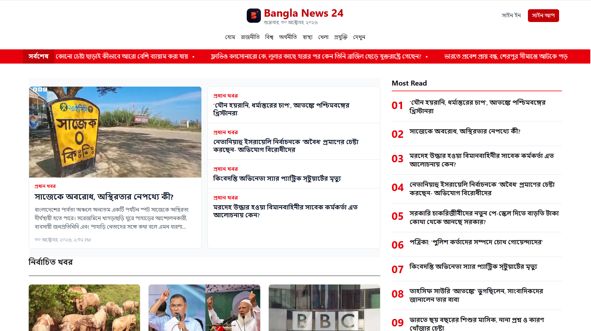

<p align="center">
  
</p>

<h1 align="center">Bangla News 24</h1>

<p align="center">
  A Bengali-language news portal built with Next.js, React, TypeScript, Tailwind CSS, and Better Auth.
</p>

---

## Table of Contents

- [Overview](#overview)
- [Key Features](#key-features)
- [Tech Stack](#tech-stack)
- [Architecture](#architecture)
- [Project Structure](#project-structure)
- [Getting Started](#getting-started)
  - [Prerequisites](#prerequisites)
  - [Installation](#installation)
  - [Environment Variables](#environment-variables)
  - [MongoDB Setup](#mongodb-setup)
  - [Google OAuth Setup](#google-oauth-setup-optional)
  - [Run Locally](#run-locally)
- [Available Scripts](#available-scripts)
- [Routes](#routes)
- [API Endpoints and Integrations](#api-endpoints-and-integrations)
- [Authentication System](#authentication-system)
- [Data Fetching, Caching, and Rendering](#data-fetching-caching-and-rendering)
- [Security Notes](#security-notes)
- [Deployment](#deployment)
- [Troubleshooting](#troubleshooting)
- [Quality Checks](#quality-checks)
- [Screenshots](#screenshots)

## Overview

**Bangla News 24** is a reader-facing Bengali news application. It consumes an external news API and presents content through a curated home page, category feeds, and full article pages. The application also includes a complete account system with email/password authentication and optional Google sign-in.

The project is built with the Next.js App Router and favors server-rendered data fetching, typed API responses, incremental caching, and responsive layouts. The interface is Bengali-first, including Bengali date and time formatting for the `Asia/Dhaka` time zone.

### Purpose

- Provide a fast, responsive Bengali news reading experience.
- Organize news into curated home-page sections and browsable categories.
- Display full article content, images, bylines, tags, and publication metadata.
- Demonstrate a production-style authentication flow using Better Auth and MongoDB.
- Showcase modern Next.js patterns: Server Components, Suspense, Cache Components, React Compiler, and typed data access.

## Key Features

- **Curated home page** with main news, selected stories, Bangladesh, India, world, health, video, extra news, and most-read sections.
- **Latest-news ticker** powered by the ten most recent headlines from the news API.
- **Dynamic category navigation** generated from the categories API, filtered to browsable categories.
- **Category pages** with responsive news-card grids and a not-found state for invalid or missing categories.
- **Article detail pages** with hero images, bylines, Bengali publication dates, structured body blocks, image captions, and tags.
- **Bengali-first UI** with the Noto Serif Bengali font and `bn-BD` date/time formatting.
- **Responsive design** with mobile-first layouts, wrapping headlines, touch-friendly controls, and adaptive navigation.
- **Email/password authentication** with client and server validation, automatic sign-in after registration, and localized error messages.
- **Optional Google OAuth** that appears only when both Google credentials are configured.
- **Protected account page** with server-verified sessions and a sign-out action.
- **Accessible interaction details** including semantic landmarks, focus-visible styles, ARIA labels, keyboard-dismissable account menu, and loading states.
- **Graceful loading states** using Suspense skeletons across pages and sections.
- **Custom 404 page** in Bengali for missing routes and content.
- **Typed news API client** with centralized fetching, caching, image URL handling, and Bengali date formatters.

## Tech Stack

| Area | Technology |
| --- | --- |
| Framework | Next.js `16.4.0` (App Router, Turbopack) |
| UI library | React `19.3.0`, React DOM `19.3.0` |
| Language | TypeScript `^5` with strict mode |
| Styling | Tailwind CSS `^4`, `@tailwindcss/turbopack`, daisyUI `^5.7.47` |
| Authentication | Better Auth `^1.7.12` |
| Database adapter | `@better-auth/mongo-adapter` `^1.7.12` |
| Database | MongoDB via the official `mongodb` driver `^7.7.0` |
| News ticker | `react-marquee-text` `^1.0.6` |
| Fonts | Noto Serif Bengali via `next/font/google` |
| Linting | ESLint `^9`, `eslint-config-next` `16.4.0` |
| Compiler tooling | `babel-plugin-react-compiler` `1.0.0` |
| Package manager | npm (`package-lock.json` is committed) |

Notable Next.js configuration in `next.config.ts`:

- `cacheComponents: true`
- `partialPrefetching: true`
- `reactCompiler: true`
- Turbopack CSS handling through `@tailwindcss/turbopack`
- Remote image optimization allowed for `ichef.bbci.co.uk`

## Architecture

```text
Browser
  │
  ├── Next.js App Router (Server Components)
  │     ├── src/lib/news.ts ───────────────► External News API
  │     ├── Category and article routes
  │     └── Suspense skeletons + cached data
  │
  └── Better Auth client (client components)
        └── /api/auth/[...all] ─────────────► Better Auth ──► MongoDB
```

The application uses Server Components for data-heavy pages and client components for interactive authentication and navigation UI. News data is fetched through a single typed module, `src/lib/news.ts`, while authentication is centralized in `src/lib/auth.ts` and exposed to the browser through `src/lib/auth-client.ts`.

## Project Structure

```text
.
├── public/
│   ├── logo.webp
│   └── ...                         # Static assets
├── src/
│   ├── app/
│   │   ├── account/
│   │   │   └── page.tsx            # Protected account page
│   │   ├── api/
│   │   │   └── auth/[...all]/
│   │   │       └── route.ts        # Better Auth route handler
│   │   ├── category/[id]/
│   │   │   └── page.tsx            # Category news feed
│   │   ├── news/[id]/
│   │   │   └── page.tsx            # Article detail page
│   │   ├── sign-in/
│   │   │   └── page.tsx            # Sign-in page
│   │   ├── sign-up/
│   │   │   └── page.tsx            # Registration page
│   │   ├── globals.css             # Tailwind and daisyUI entry point
│   │   ├── layout.tsx              # Root layout and site chrome
│   │   ├── not-found.tsx           # Custom 404 page
│   │   └── page.tsx                # Home page
│   ├── components/
│   │   ├── auth/                   # Auth navigation, shell, sign-out
│   │   ├── forms/                  # Sign-in, sign-up, Google, fields
│   │   ├── layout/                 # Header, nav, ticker, footer
│   │   └── news/                   # Home sections, cards, most-read
│   ├── lib/
│   │   ├── auth.ts                 # Better Auth server configuration
│   │   ├── auth-client.ts          # Better Auth browser client
│   │   ├── auth-validation.ts      # Validation, safe redirects, errors
│   │   ├── news.ts                 # News API client and formatters
│   │   └── session.ts              # Server session helpers
│   ├── types/
│   │   ├── Catagories.ts           # Category response type
│   │   └── news.ts                 # News API response types
│   └── proxy.ts                    # Route protection for /account
├── .env.example                    # Environment variable template
├── eslint.config.mjs
├── next.config.ts
├── package.json
├── package-lock.json
└── tsconfig.json
```

## Getting Started

### Prerequisites

- **Node.js** compatible with Next.js 16
- **npm** (the repository includes `package-lock.json`)
- A **MongoDB** database, such as MongoDB Atlas or a self-hosted instance
- A **Google Cloud OAuth client** (optional, only for Google sign-in)

### Installation

1. Clone the repository:

   ```bash
   git clone https://github.com/aminulislamdev/News.git
   cd News
   ```

2. Install dependencies:

   ```bash
   npm install
   ```

3. Create a local environment file:

   ```bash
   cp .env.example .env
   ```

   On Windows PowerShell:

   ```powershell
   Copy-Item .env.example .env
   ```

4. Fill in the required values described below. Never commit `.env`.

5. Start the development server:

   ```bash
   npm run dev
   ```

6. Open [http://localhost:3000](http://localhost:3000).

### Environment Variables

Create `.env` from `.env.example` and use placeholder values locally. Do not commit real credentials.

| Variable | Required | Purpose |
| --- | --- | --- |
| `BETTER_AUTH_SECRET` | Yes | Secret used to sign and encrypt authentication data. Must be at least 32 characters. |
| `BETTER_AUTH_URL` | Yes | Public origin of the application. Use `http://localhost:3000` locally and your HTTPS origin in production. |
| `MONGODB_URI` | Yes* | MongoDB connection string. Include the database name in the URI. |
| `DB_USER` | Alternative* | Database user when using the split configuration instead of `MONGODB_URI`. |
| `DB_PASSWORD` | Alternative* | Database password for the split configuration. |
| `MONGODB_HOST` | Alternative* | MongoDB host for the split configuration. |
| `MONGODB_DB` | Optional | Database name override. Required if the URI does not include a database name. Defaults to `news` for the split configuration. |
| `GOOGLE_CLIENT_ID` | Optional | Google OAuth client ID. Required only for Google sign-in. |
| `GOOGLE_CLIENT_SECRET` | Optional | Google OAuth client secret. Server-side only; never expose it to the browser. |
| `NEWS_API_BASE_URL` | Optional | Override for the external news API base URL. Defaults to `https://news-api-fs.vercel.app/api/v2`. |

\* Provide either `MONGODB_URI` **or** the split settings `DB_USER`, `DB_PASSWORD`, and `MONGODB_HOST`. The application does not silently fall back to MongoDB's `test` database when a database name is missing.

Example `.env` values with placeholders only:

```dotenv
BETTER_AUTH_SECRET=<at-least-32-random-characters>
BETTER_AUTH_URL=http://localhost:3000

MONGODB_URI=mongodb+srv://<user>:<password>@<cluster-host>/<database>?retryWrites=true&w=majority

GOOGLE_CLIENT_ID=<google-client-id>.apps.googleusercontent.com
GOOGLE_CLIENT_SECRET=<google-client-secret>

NEWS_API_BASE_URL=https://news-api-fs.vercel.app/api/v2
```

Generate a secure authentication secret with:

```bash
node -e "console.log(require('crypto').randomBytes(32).toString('base64'))"
```

### MongoDB Setup

- Use a MongoDB user with read/write access to the configured database.
- Include the database name in `MONGODB_URI`, or set `MONGODB_DB` explicitly.
- Better Auth creates its collections and indexes automatically. No migration step is required.
- For MongoDB Atlas, make sure the deployment environment is allowed by the cluster's network access rules.

### Google OAuth Setup (Optional)

Google sign-in is enabled only when **both** `GOOGLE_CLIENT_ID` and `GOOGLE_CLIENT_SECRET` are set. If only one is present, the server throws a configuration error instead of starting with a partially configured provider.

1. Open the [Google Cloud Console](https://console.cloud.google.com/) and create or select a project.
2. Configure the **OAuth consent screen**.
3. Create an **OAuth client ID** with the application type **Web application**.
4. Add the authorized JavaScript origin:

   ```text
   http://localhost:3000
   ```

5. Add the authorized redirect URI:

   ```text
   http://localhost:3000/api/auth/callback/google
   ```

6. Copy the client ID and client secret into `.env`.
7. Restart the development server after changing environment variables.

For production, replace `http://localhost:3000` with your HTTPS domain in both Google Cloud and `BETTER_AUTH_URL`. The callback path is always `/api/auth/callback/google`.

### Run Locally

```bash
npm run dev
```

The development server runs at [http://localhost:3000](http://localhost:3000). The home page, category pages, and article pages fetch live data from the configured news API.

## Available Scripts

| Command | Description |
| --- | --- |
| `npm run dev` | Start the Next.js development server. |
| `npm run build` | Create an optimized production build. |
| `npm start` | Start the production server after a build. |
| `npm run lint` | Run ESLint. |

## Routes

| Route | Description |
| --- | --- |
| `/` | Home page with curated news sections, latest-news ticker, and most-read list. |
| `/category/[id]` | Category feed identified by category slug. |
| `/news/[id]` | Full article page with body content, images, byline, and tags. |
| `/sign-in` | Email/password sign-in, with optional Google sign-in. |
| `/sign-up` | Account registration, with optional Google sign-in. |
| `/account` | Protected account page showing the signed-in user's name, email, and membership date. |
| `/api/auth/[...all]` | Better Auth catch-all API route. |
| Any unknown route | Custom Bengali not-found page. |

## API Endpoints and Integrations

### Internal API

| Method | Endpoint | Description |
| --- | --- | --- |
| `GET`, `POST`, `PATCH`, `PUT`, `DELETE` | `/api/auth/[...all]` | Better Auth route handler for registration, sign-in, sign-out, sessions, and OAuth callbacks. |
| `GET` | `/api/auth/callback/google` | Google OAuth callback handled by Better Auth. Requires Google credentials. |

### External News API

The application consumes the news service configured by `NEWS_API_BASE_URL`. Requests are made server-side from `src/lib/news.ts`; the application does not expose these news endpoints as its own public API.

| Method | Path | Used for |
| --- | --- | --- |
| `GET` | `/news/sections` | Curated home-page sections. |
| `GET` | `/news?limit=10` | Latest headlines for the ticker. |
| `GET` | `/news/most-read` | Most-read news list. |
| `GET` | `/categories` | Category navigation. |
| `GET` | `/category/{slug}` | Category news feed. |
| `GET` | `/article/{id}` | Full article details. |

Integration behavior:

- Responses are typed in `src/types/news.ts`.
- Non-success responses are converted to typed failures in `src/lib/news.ts`.
- `400` and `404` responses for categories and articles produce the app's not-found page.
- Other upstream failures throw descriptive errors.
- News image URLs can contain a `{width}` placeholder, which is replaced before rendering.
- Remote image optimization is configured for `ichef.bbci.co.uk` in `next.config.ts`.

## Authentication System

Authentication is implemented with **Better Auth** and the **MongoDB adapter**.

### Supported methods

- **Email and password**
  - Enabled in `src/lib/auth.ts`.
  - Minimum password length: 8 characters.
  - Maximum password length: 128 characters.
  - New accounts are signed in automatically after registration.
- **Google OAuth**
  - Optional and enabled only when both Google credentials are configured.
  - Uses Google's account-selection prompt.
  - The UI renders the Google button only when the provider is enabled.

### Sessions and route protection

- Sessions are managed by Better Auth and stored in MongoDB.
- The browser receives an HttpOnly session cookie.
- `src/proxy.ts` protects `/account` and redirects unauthenticated visitors to `/sign-in` with a safe `callbackUrl`.
- The account page additionally verifies the session on the server through `requireSession()` in `src/lib/session.ts`.
- Signed-in users visiting `/sign-in` or `/sign-up` are redirected to a safe destination.

### Validation and error handling

- Client-side validation covers name, email, password length, and password confirmation.
- Name length is limited to 80 characters.
- Email addresses are normalized to lowercase before submission.
- Better Auth errors are mapped to safe Bengali messages for duplicate accounts, invalid credentials, rate limits, network failures, and validation errors.
- OAuth errors are mapped to localized messages; raw provider descriptions are never rendered.
- `getSafeCallbackUrl()` rejects external URLs, protocol-relative URLs, backslashes, control characters, API routes, and auth pages to prevent open redirects and redirect loops.

### Account page

`/account` displays:

- The user's name
- The user's email
- The account creation date formatted in Bengali
- A sign-out action

### Not configured

Email verification and password reset are not enabled because no mail provider is configured. New accounts are active immediately.

## Data Fetching, Caching, and Rendering

- **Server Components** fetch news data and render the home, category, and article pages.
- **Centralized data access** lives in `src/lib/news.ts`.
- **Incremental caching** uses Next.js `"use cache"` with `cacheLife("minutes")` for sections, latest news, most-read news, categories, category feeds, and articles.
- **Suspense boundaries** provide skeleton loading states for the home sections, category page, article page, and account page.
- **Partial prerendering and prefetching** are enabled through the Next.js configuration.
- **React Compiler** is enabled in `next.config.ts`.
- **Bengali formatting** uses `Intl.DateTimeFormat` with the `bn-BD` locale and `Asia/Dhaka` time zone.
- **Image handling** uses `next/image`; article image URLs are normalized for different CDN width representations.

## Security Notes

- Never commit `.env` or real credentials.
- `BETTER_AUTH_SECRET` must be at least 32 characters; the server refuses to start otherwise.
- `GOOGLE_CLIENT_SECRET` is read only on the server.
- Authentication sessions are verified on the server for protected pages.
- Callback URLs are restricted to same-origin application paths.
- OAuth error codes are translated through an allowlist rather than displaying raw provider messages.
- The MongoDB user should have the minimum permissions required by the application.

## Deployment

### Vercel

Vercel is the simplest deployment target for this Next.js application.

1. Push the repository to GitHub.
2. Import the repository into Vercel.
3. Add all required environment variables in the Vercel project settings.
4. Set `BETTER_AUTH_URL` to the production HTTPS origin.
5. Add the production Google redirect URI in Google Cloud:

   ```text
   https://<your-domain>/api/auth/callback/google
   ```

6. Ensure the MongoDB cluster allows connections from the deployment environment.
7. Deploy using the default Next.js build settings, or explicitly use:

   ```bash
   npm run build
   ```

### Generic Node.js hosting

```bash
npm ci
npm run build
npm start
```

Set the same environment variables in the hosting provider. The application must be served over HTTPS in production for secure authentication cookies and OAuth callbacks.

### Post-deployment checklist

- [ ] `BETTER_AUTH_SECRET` is set and at least 32 characters.
- [ ] `BETTER_AUTH_URL` matches the public HTTPS origin.
- [ ] MongoDB is reachable and the database name is configured.
- [ ] Google OAuth origins and redirect URIs match the production domain.
- [ ] `GOOGLE_CLIENT_SECRET` is present only in server-side environment variables.
- [ ] The production build completes successfully.
- [ ] `/account` redirects to `/sign-in` when signed out.
- [ ] Email/password and Google sign-in both work if enabled.

## Troubleshooting

| Symptom | Likely cause and fix |
| --- | --- |
| `BETTER_AUTH_SECRET must be set and at least 32 characters long.` | Add a secret of at least 32 characters to `.env`. |
| `MongoDB is not configured...` | Set `MONGODB_URI`, or set `DB_USER`, `DB_PASSWORD`, and `MONGODB_HOST`. |
| `MongoDB database name is missing...` | Include a database name in `MONGODB_URI` or set `MONGODB_DB`. |
| `Google sign-in is partially configured...` | Set both Google credentials or remove both. |
| Google redirects back with an error | Verify `BETTER_AUTH_URL` and the authorized redirect URI in Google Cloud. |
| News pages fail to load | Check `NEWS_API_BASE_URL`, network access, and the upstream API status. |
| Images fail to load | Confirm the image host is allowed by `next.config.ts`. |

## Quality Checks

The project currently has no automated test script. Use the following checks before opening a pull request or deploying:

```bash
npm run lint
npm run build
```

The production build runs TypeScript checks and generates the App Router routes.

## Screenshots

### Desktop



### Mobile

<p>
  
</p>
